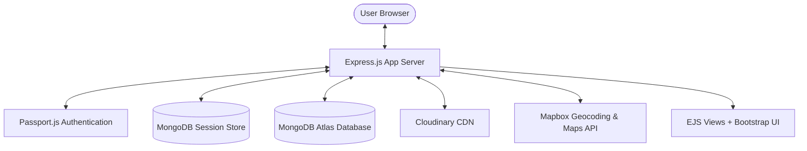

# 🏡 LuxHevan — Luxury Holiday Homes & Stay Reservation Platform

[](https://nodejs.org/)
[](https://expressjs.com/)
[](https://www.mongodb.com/)
[](https://cloudinary.com/)
[](https://www.mapbox.com/)
[](https://getbootstrap.com/)

**LuxHevan** is a full-stack vacation rental and holiday homes platform inspired by Airbnb. It allows travelers to discover unique stays across the globe, filter through curated categories, book reservations with live pricing, read and leave reviews, and host their own properties with geocoded maps and cloud image uploads.

---

## ✨ Features

### 🔍 Discovery & Smart Search
- **Multi-Field Search**: Search by city, country, title, description, category, or price (e.g. `Malibu`, `Aspen`, `Villa`, `50000`).
- **14 Curated Relatable Categories**:
  - 🏖️ Beachfront &bull; 🪵 Cabins &bull; 🏡 Villas &bull; 🏙️ Iconic Cities &bull; ⛰️ Mountains
  - 🌊 Lakefront &bull; 🏊 Amazing Pools &bull; 🌾 Countryside &bull; 🌴 Tropical &bull; 🌲 Treehouses
  - ✨ Luxe &bull; 🛏️ Rooms &bull; 🏰 Historic &bull; 🏞️ National Parks
- **Modern Filters Modal**: Interactive popup modal with destination input, category chips, min/max price controls, and quick price presets (`Under ₹25k`, `₹25k–₹60k`, `₹60k+`).
- **Interactive Taxes Toggle**: Switch between nightly base price and live total after taxes (18% GST).
- **Responsive Category Bar**: Smooth horizontal scrolling with floating arrow controls.

### 📅 Stays & Reservations
- **Live Stay Booking**: Real-time reservation engine that calculates nights, stay price, 12% service fee, and 18% taxes.
- **Date Conflict Prevention**: Automatically checks for existing reservations and prevents overlapping bookings.
- **Trips Dashboard**: View upcoming and completed reservations (`/bookings`) with one-click cancellation.

### 🏠 Property Hosting & Listings
- **Host Your Home**: Create listings with titles, descriptions, pricing, categories, and cloud photo uploads.
- **Interactive Mapbox Geolocation**: Automatic forward geocoding converts text addresses into latitude/longitude coordinates displayed on an interactive Mapbox map.
- **Owner Controls**: Secure editing and deletion restricted strictly to the listing owner.

### 💬 Reviews & Ratings
- **Star Ratings & Feedback**: Authenticated guests can submit 1–5 star reviews with comments.
- **Author Protection**: Only the review author can delete their respective reviews.

### 🔐 User Profiles & Security
- **Authentication**: Passport.js Local Strategy with salted and hashed passwords (`passport-local-mongoose`).
- **Session Management**: Persistent sessions stored in MongoDB via `connect-mongo`.
- **Profile Management**: Update profile details, change passwords, upload profile avatars to Cloudinary, and manage hosted stays.
- **Input Validation**: Robust schema validation on both client and server sides using **Joi**.

---

## 🏗️ Architecture & Technology Stack



| Layer | Technologies |
| :--- | :--- |
| **Backend Runtime** | Node.js (v18+) |
| **Web Framework** | Express.js 4.x |
| **Database & ODM** | MongoDB Atlas, Mongoose 7.x |
| **View Engine** | EJS, EJS-Mate layouts |
| **Authentication** | Passport.js, Passport-Local, Passport-Local-Mongoose |
| **Session Store** | express-session, connect-mongo |
| **Image Hosting** | Cloudinary, Multer, multer-storage-cloudinary |
| **Maps & Location** | Mapbox SDK, Mapbox GL JS |
| **Data Validation** | Joi |
| **Frontend Styling** | Bootstrap 5, FontAwesome 6, Custom CSS |

---

## 📁 Project Directory Structure

```text
LuxHevan/
├── controllers/          # Request handlers and business logic
│   ├── bookings.js       # Booking reservations and cancellations
│   ├── listings.js       # Listings CRUD, search, and category filters
│   ├── profiles.js       # User profile and stay management
│   ├── reviews.js        # Review creation and deletion
│   └── users.js          # Authentication and account management
├── models/               # Mongoose data schemas
│   ├── booking.js        # Reservation model (guest, listing, dates, price)
│   ├── listing.js        # Property listing model (geometry, image, owner)
│   ├── review.js         # Review model (rating, comment, author)
│   └── user.js           # User model (passport-local-mongoose)
├── routers/              # Express route declarations
│   ├── listing.js        # /listings routes
│   ├── profile.js        # /profile routes
│   ├── review.js         # /listings/:id/reviews routes
│   └── user.js           # Auth (/signup, /login, /logout) & booking routes
├── views/                # EJS template views
│   ├── bookings/         # Booking history views
│   ├── includes/         # Navbar, footer, flash alerts, filters modal
│   ├── layouts/          # Boilerplate HTML layout wrapper
│   ├── listings/         # Index, show, new, edit, and error views
│   ├── profiles/         # User profile views
│   └── users/            # Login, signup, and account update views
├── public/               # Static client assets
│   ├── css/              # Stylesheets (filter.css, filterbtn.css, show.css, etc.)
│   ├── js/               # Client scripts (filter.js, filterIcon.js, map.js, etc.)
│   └── Icon/             # UI icons and category badges
├── init/                 # Database initialization and seeding
│   ├── data.js           # 29 curated sample listings worldwide
│   └── index.js          # Database seeding script with relatable categories
├── utils/                # Error handling and helper utilities
├── cloudConfig.js        # Cloudinary and Multer storage setup
├── middleware.js         # Auth checks, validation, and ownership middleware
├── schema.js             # Joi validation schemas
├── app.js                # Main application server entry point
├── package.json          # Node dependencies and project metadata
└── .env                  # Environment variables (create from template)
```

---

## 🚀 Getting Started

### 1. Prerequisites
- [Node.js](https://nodejs.org/) (version 18.x or later)
- [MongoDB](https://www.mongodb.com/) (local instance or free MongoDB Atlas cluster)
- [Cloudinary](https://cloudinary.com/) free account (for image uploads)
- [Mapbox](https://account.mapbox.com/) free public token (for maps and geocoding)

---

### 2. Installation

1. **Clone the repository**:
   ```bash
   git clone https://github.com/your-username/LuxHevan.git
   cd LuxHevan
   ```

2. **Install dependencies**:
   ```bash
   npm install
   ```

---

### 3. Environment Configuration

Create a `.env` file in the root directory and supply your credentials:

```env
# MongoDB Atlas Connection URL
ATLASDB_URL=mongodb+srv://<username>:<password>@<cluster>.mongodb.net/luxhevan?retryWrites=true&w=majority

# Session Secret (random long string)
SECRET=your_super_secret_session_key_12345

# Cloudinary Credentials (Settings > Access Keys)
CLOUD_NAME=your_cloudinary_cloud_name
CLOUD_API_KEY=your_cloudinary_api_key
CLOUD_API_SECRET=your_cloudinary_api_secret

# Mapbox Public Access Token (Account > Tokens)
MAP_TOKEN=pk.eyJ1IjoieW91ci11c2VybmFtZSIsImEiOiJ5b3VyLXRva2VuIn0...
```

---

### 4. Seed the Database

Populate your database with the 29 curated luxury sample stays:

```bash
node init/index.js
```

You should see:
```text
Connected to MongoDB for initialization.
Using owner ID: <your_user_id>
Successfully seeded 29 listings with curated relatable categories!
Disconnected from MongoDB.
```

---

### 5. Run the Application

Start the development server:

```bash
node app.js
```

Open your browser and navigate to:
```text
http://localhost:8080
```

---

## 🌐 API & Route Reference

### Listings (`/listings`)
| Method | Route | Description | Auth Required |
| :--- | :--- | :--- | :---: |
| `GET` | `/listings` | Display all property listings | No |
| `GET` | `/listings/new` | Render new property form | **Yes** |
| `POST` | `/listings` | Create listing with geocoding & photo | **Yes** |
| `GET` | `/listings/:id` | View property details, map & reviews | No |
| `GET` | `/listings/:id/edit`| Render property edit form | **Yes (Owner)** |
| `PUT` | `/listings/:id` | Update listing details & photo | **Yes (Owner)** |
| `DELETE`| `/listings/:id` | Delete listing & associated reviews | **Yes (Owner)** |
| `GET` | `/listings/filter/:id`| Filter listings by category | No |
| `GET` | `/listings/search` | Search by keyword, price range, category | No |

### Reservations (`/listings/:id/book` & `/bookings`)
| Method | Route | Description | Auth Required |
| :--- | :--- | :--- | :---: |
| `POST` | `/listings/:id/book`| Reserve a stay with dates & guests | **Yes** |
| `GET` | `/bookings` | View current user's trips | **Yes** |
| `DELETE`| `/bookings/:id` | Cancel a reservation | **Yes (Guest)** |

### Reviews (`/listings/:id/reviews`)
| Method | Route | Description | Auth Required |
| :--- | :--- | :--- | :---: |
| `POST` | `/listings/:id/reviews` | Post a 1–5 star review | **Yes** |
| `DELETE`| `/listings/:id/reviews/:reviewId` | Delete a review | **Yes (Author)** |

### User & Authentication (`/`)
| Method | Route | Description | Auth Required |
| :--- | :--- | :--- | :---: |
| `GET` | `/signup` | Render registration page | No |
| `POST` | `/signup` | Register new user account | No |
| `GET` | `/login` | Render login page | No |
| `POST` | `/login` | Authenticate user credentials | No |
| `GET` | `/logout` | Terminate session & log out | **Yes** |
| `GET` | `/profile` | View profile, listings & reviews | **Yes** |
| `POST` | `/update-account/:id`| Update name, username, email | **Yes (Self)** |
| `POST` | `/update-password/:id`| Change account password | **Yes (Self)** |
| `DELETE`| `/delete/:id` | Delete user account & cascade data | **Yes (Self)** |

---

## 🛡️ Security & Validation
- **Authentication Guards**: Custom `isLoggedIn` middleware prevents unauthorized access to protected routes.
- **Authorization & Ownership**: `isOwner`, `isProfileOwner`, and `isReviewAuthor` verify that users can only modify their own data.
- **Joi Validation**: Strict schemas validate listings, user registration, and reviews prior to database operations.
- **Session Security**: Session cookies configured with `httpOnly: true`, 7-day expiration, and signed using a secure secret.

---

## 📄 License
This project is licensed under the [ISC License](LICENSE).
